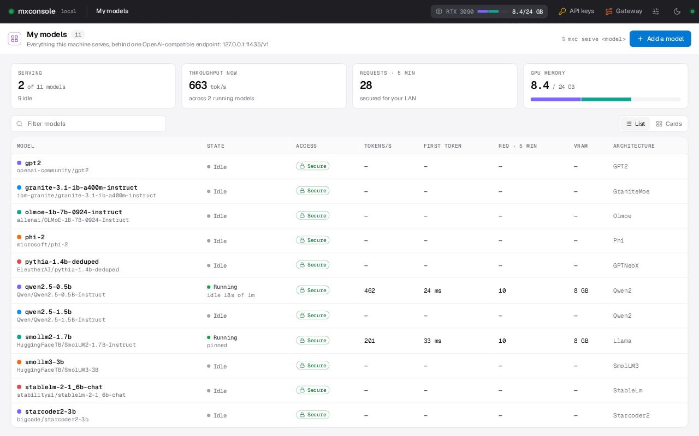

# omxconsole (archived: the earlier Python version)

> **Archived.** This is the earlier Python version of omxconsole (`mxc`). The current omxconsole is a desktop app
> built with [omxcode](https://github.com/abhisheksreesaila/omxcode):
> **[see it](https://abhisheksreesaila.github.io/omxcode/omxconsole.html)** ·
> [source](https://github.com/abhisheksreesaila/omxcode/tree/main/examples/console). This repository is read-only;
> its old site pages are kept under [docs/archive-site](docs/archive-site/).


**Local AI on Modular MAX, made easy.** One command gives you an OpenAI-compatible endpoint. Models load when
they're called and unload when idle. If MAX can't run a model yet, omxconsole can port it for you.

[](https://github.com/abhisheksreesaila/mxstudio/releases/latest)




**See it live: [the omxconsole site](https://abhisheksreesaila.github.io/mxstudio/site/)**

```bash
git clone https://github.com/abhisheksreesaila/mxstudio.git && cd mxstudio
pixi install && pixi run mxc serve qwen2.5-0.5b   # prints a URL, a key and a curl line
```

| | |
|---|---|
| [User guide](docs/USER_GUIDE.md) | Install, first ten minutes, the console, LAN access, troubleshooting |
| [Console tour](https://abhisheksreesaila.github.io/mxstudio/site/console.html) | Every screen, clickable, explained |
| [HTTP API](docs/API.md) | The OpenAI-compatible endpoints, keys and errors |
| [CLI reference](docs/CLI.md) | Every `mxc` command and option |
| [Porting](https://abhisheksreesaila.github.io/mxstudio/site/porting.html) | How omxconsole ports a model MAX can't run yet ([PORTING.md](docs/PORTING.md)) |
| [How it works](docs/ARCHITECTURE.md) | The daemon, keys, expose and porting; running the tests |
| [Releases](https://github.com/abhisheksreesaila/mxstudio/releases) · [changelog](CHANGELOG.md) | What's new |
