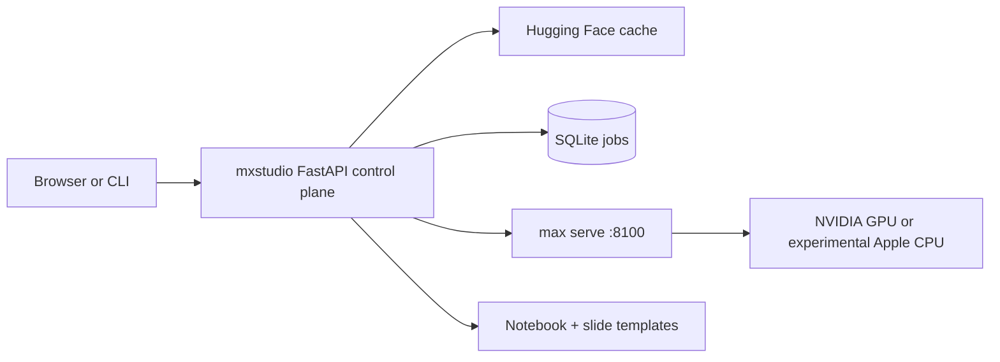

# mxstudio

**A local workbench for learning, serving, and extending language models with Modular MAX.**

mxstudio turns the path from a Hugging Face checkpoint to a running MAX endpoint into one visible workflow: inspect the model, check local fit, download it, serve it, chat, benchmark it, and open an editable learning lab that explains what is happening.

The goal is not to hide MAX behind another abstraction. The goal is to make MAX easier to approach, observe, and learn from.

> **Project status:** early and experimental. Curated dense models are the easiest place to start. Architectures is a beta workflow: inspection and scaffolding are automated, while graph implementation and numerical validation remain engineering work. The OLMoE port is not a production guarantee; numerical parity validation is still pending.

## Why mxstudio exists

Model serving often starts with scattered commands, architecture compatibility guesses, and little connection between the model paper and the process running on the GPU. mxstudio puts those pieces next to each other:

- **Models:** discover curated or cached Hugging Face checkpoints and manage downloads.
- **Serve and Chat:** run one managed `max serve` process with an OpenAI-compatible API.
- **🧭 Local Agent:** let a served model inspect mxstudio through bounded, read-only tools with a visible trace.
- **Notebooks and Slides:** generate editable, cited lessons for each model.
- **Benchmark:** measure time to first token and generation throughput on this machine.
- **Architectures:** inspect MAX support and guide custom architecture bring-up honestly.
- **Learn:** connect model systems concepts to compact GPU and Mojo learning material.

mxstudio is intended for learners, MAX evaluators, and developers porting open models. It is not a production inference control plane or an automatic model-porting service.

## Does it use an LLM to create notebooks or slides?

**No. Notebook and slide generation is deterministic and local.** Python templates combine the curated model registry with a programmatically filtered excerpt from the Hugging Face model card. No model is prompted to write the lesson, and no cloud LLM API is used.

| Activity | Local model required? |
| --- | --- |
| Open the UI and browse Models or Learn | No |
| Inspect hardware and MAX compatibility | No |
| Generate or read a notebook and slide deck | No |
| Fetch a fresh Hugging Face model-card excerpt | No model; internet may be needed |
| Scaffold a custom architecture package | No |
| Chat, run notebook inference cells, or benchmark generation | **Yes** |

Generated notebook code calls the local OpenAI-compatible MAX endpoint only after you choose **Serve**. The static Learn material and GPU visualizers do not execute Mojo; they are explanatory assets. Custom MAX graph implementation remains engineering work for a person or coding agent.

## 🧭 Local agent

Open the floating chat panel and switch from **Chat** to **Agent**. The active local MAX model can gather evidence from mxstudio before answering:

- 🔎 inspect the active MAX server and served model;
- 🖥️ read the local CPU, GPU, memory, and disk summary;
- 📊 read recent benchmark results;
- 🧾 show every tool call and result inline before the final answer.

The agent is deliberately bounded: tools are allowlisted and read-only, and a configurable maximum step count stops repeated tool calls. It cannot execute arbitrary commands, edit files, download models, or control the server.

> **Model requirement:** Agent mode needs a served model and chat template that support OpenAI-style tool calls. Ordinary Chat mode remains available for models without tool support.

## Recommended first model

Model weights are **not bundled** with mxstudio. Bundling would make the repository large, complicate model licenses, and choose hardware requirements on the user's behalf. Hugging Face downloads also remain reusable in the normal local cache.

For a first run, use **Qwen2.5 0.5B Instruct**:

- about 1 GB to download;
- ungated and Apache 2.0 licensed;
- quick to compile and serve;
- sufficient for testing chat, streaming, notebooks, and the OpenAI API.

Treat it as a starter cartridge, not a permanent default. Once the workflow is clear, switch to a larger or more specialized model from the Models catalog.

## Requirements

- Linux x86-64, WSL2, or Apple silicon macOS
- For the primary serving path, a supported NVIDIA GPU and working driver (`nvidia-smi` should succeed)
- On Apple silicon, enough unified memory for the model and experimental MAX CPU serving
- [Pixi](https://pixi.sh/) for the isolated project environment
- Git
- Internet access for initial packages and model downloads
- A Hugging Face token only for gated models such as Llama or Gemma

MAX is installed into the repository-local Pixi environment. mxstudio does not modify the system Python environment.

> **Apple silicon preview:** mxstudio installs natively on `osx-arm64` and starts MAX with `--devices cpu`. This is suitable for learning the workflow with a small model such as Qwen2.5 0.5B. It does not enable Apple GPU inference, and serving or benchmarking will be slower than the NVIDIA GPU path.

## Install

1. Install Pixi if it is not already available:

   ```bash
   curl -fsSL https://pixi.sh/install.sh | sh
   ```

   Start a new shell after installation, or add `~/.pixi/bin` to `PATH`.

2. Clone and enter the project:

   ```bash
   git clone https://github.com/abhisheksreesaila/mxstudio.git
   cd mxstudio
   ```

3. Create the isolated environment:

   ```bash
   pixi install
   ```

4. Start mxstudio:

   ```bash
   pixi run studio
   ```

5. Open <http://localhost:8080>.

If port 8080 is occupied, start the CLI directly with another port:

```bash
pixi run mxs ui --port 8081
```

## First ten minutes

### Browser workflow

1. Open **Models**.
2. Download **Qwen2.5 0.5B Instruct**.
3. Select **Serve** and wait for the status to become **Running**.
4. Open Chat and send a short prompt.
5. Select **Details → Create lab** to generate its notebook and slides.
6. Run the notebook cells, then use **Benchmark** to measure this machine.
7. Return to Models and choose a different checkpoint when you need more capability.

### CLI workflow

```bash
pixi run mxs list
pixi run mxs download qwen2.5-0.5b
pixi run mxs serve qwen2.5-0.5b
pixi run mxs chat "Explain grouped-query attention in three bullets."
pixi run mxs notebook qwen2.5-0.5b
pixi run mxs bench --runs 3
pixi run mxs stop
```

Model names resolve by a unique substring, so `qwen2.5-0.5b`, `smollm`, and `olmoe` can be used instead of full Hugging Face IDs.

### Automated first-run acceptance test

The live harness follows the same path as a new user: it verifies the environment and Hugging Face metadata, downloads the public Qwen2.5 0.5B checkpoint, creates its notebook and presentation, starts MAX, streams one chat response, and stops the server it started.

```bash
pixi run python scripts/first_run_live.py
```

No Hugging Face token is required for this model. The harness refuses gated models, unsupported models, and replacement of an already-running server. Its first run downloads about 1 GB and may take several minutes to compile and serve. The hermetic regression test, which does not download weights or start MAX, is:

```bash
pixi run python -m unittest tests.test_first_run_acceptance
```

## Hugging Face access

Public models need no token. For gated or private models, create a read token in Hugging Face and save it from **Settings**. mxstudio stores it at `~/.mxstudio/secrets.json` with restrictive permissions. Never commit a token.

Before downloading an arbitrary `org/model`, mxstudio checks its config, safetensors, disk estimate, approximate VRAM fit, and declared architecture. Compatibility is advisory: a successful check is not proof that graph compilation or serving will work.

## What runs where



- The web UI and REST API run on port 8080 by default.
- A single managed `max serve` process runs on port 8100.
- Slow work such as downloads and benchmarks runs as background jobs.
- Browser chat proxies MAX's streaming OpenAI-compatible response.
- Agent mode uses `/api/agent` and exposes each read-only tool call and result as an SSE trace.
- Generated notebooks live under `notebooks/`; custom ports live under `ports/`.
- Runtime state and logs live under `~/.mxstudio/`.

## Repository map

```text
notebooks/mxstudio/          Python package and static web UI
├── api.py                   FastAPI routes, chat proxy, and agent endpoint
├── agents.py                Bounded local agent loop and read-only tools
├── registry.py              Curated model metadata
├── downloads.py             Hugging Face cache and downloads
├── servers.py               Managed max serve lifecycle
├── notebooks.py             Deterministic notebook generation and execution
├── slides.py                Deterministic Reveal.js deck generation
├── architectures.py         Custom architecture inspection and scaffolding
└── web/                     No-build HTML, CSS, and JavaScript frontend
ports/                        Custom MAX architecture packages
notebooks/                    Generated learning labs and slide sidecars
tests/                        Reliability and metadata tests
```

For a deeper code-level description, see [docs/MXSTUDIO_ARCHITECTURE.md](docs/MXSTUDIO_ARCHITECTURE.md).

## Current boundaries

- MAX architecture checks are guidance, not compile proof.
- The custom architecture wizard scaffolds structure; it does not invent a correct graph.
- OLMoE compile, strict weight loading, and local chat are verified on the development machine, but numerical parity remains to be validated.
- Mojo tutorials and visualizers are currently static educational content.
- One model is served at a time to avoid accidental VRAM overcommit.
- Live GPU/MAX integration still depends on the user's hardware and driver environment.

## Contributing

Useful contributions include verified model metadata, MAX architecture adapters, notebook lessons, hardware reports, benchmark evidence, and reliability tests. When reporting a serving result, include the GPU, driver, MAX version, model ID, command, and relevant log tail.

## License

Project licensing has not yet been declared in this repository. Model weights retain their publishers' licenses; check every model card before redistribution or deployment.