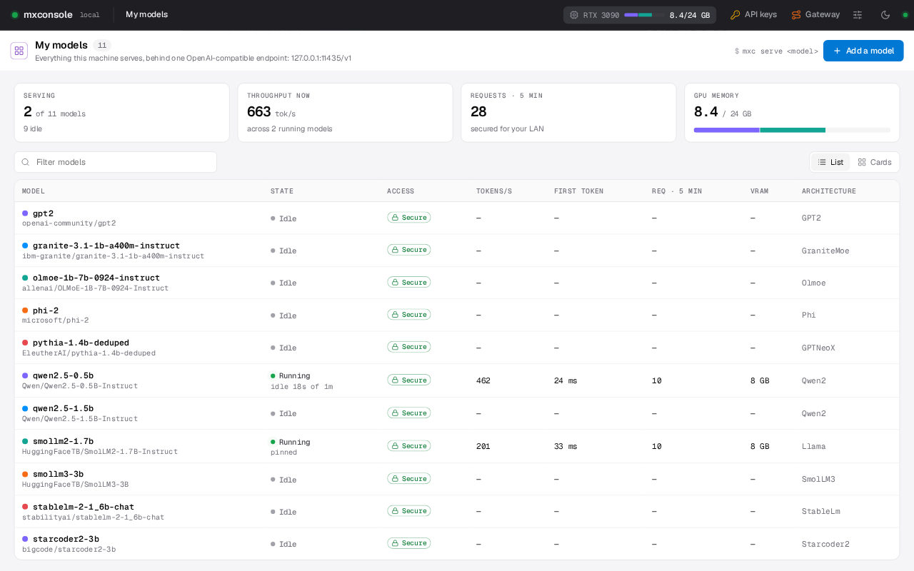
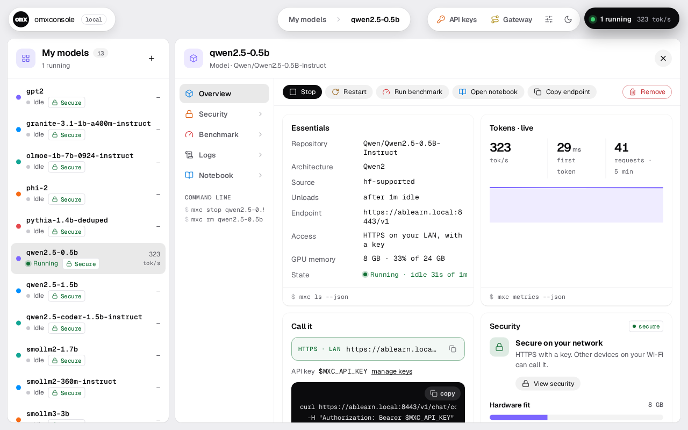
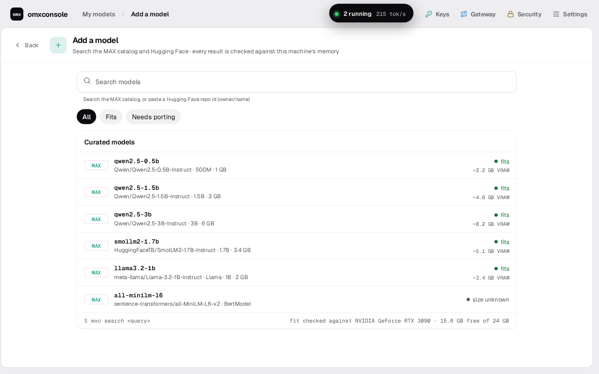
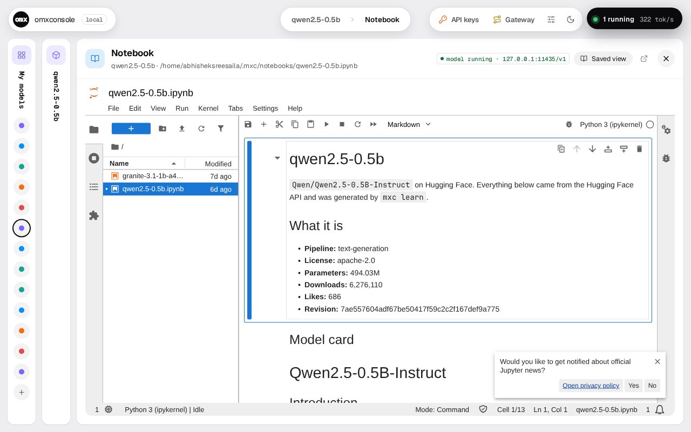
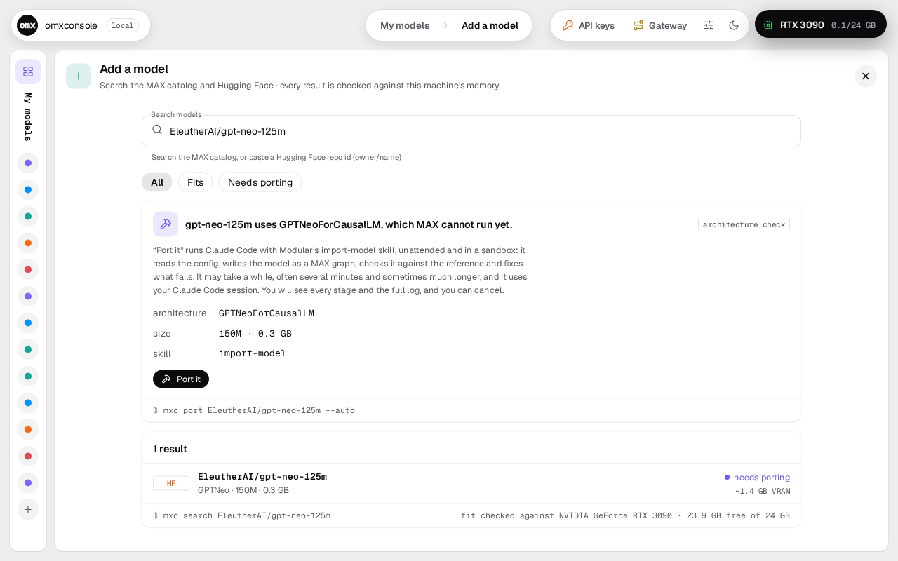

# omxconsole

**Local AI on Modular MAX, made easy.** One command gives you an OpenAI-compatible endpoint. Models load when
they're called and unload when idle. If MAX can't run a model yet, omxconsole can port it for you.

[](https://github.com/abhisheksreesaila/mxstudio/releases/latest)


**Docs:** [Overview](https://abhisheksreesaila.github.io/mxstudio/site/) ·
[Console tour](https://abhisheksreesaila.github.io/mxstudio/site/console.html) (every screen, explained) ·
[Porting, behind the scenes](https://abhisheksreesaila.github.io/mxstudio/site/porting.html) ·
[User guide](docs/USER_GUIDE.md) · [CLI reference](docs/CLI.md)



## Why

[Modular MAX](https://www.modular.com/max) is a fast inference engine. omxconsole is a convenience wrapper
around it, for running models on your own machine.

- **Local AI, easy.** `mxc serve qwen2.5-0.5b` downloads the model, starts it and prints a URL, a key and a
  `curl` line. Any OpenAI client works with it.
- **Many models, one endpoint.** Each model starts on its first request and stops after it has been idle for a while,
  so you can register a dozen and only pay GPU memory for the ones in use. Pin the ones you want kept loaded.
- **Safe to share.** One revocable key per app. `mxc expose` puts it on your LAN over HTTPS.
- **Porting, fast.** When MAX doesn't support an architecture yet, `mxc port <repo> --auto` has Claude Code
  write a MAX version in a sandbox. omxconsole then checks that it matches the Hugging Face original and serves
  it. That takes about 7–40 minutes and $2–5 of Claude usage. [How it works](https://abhisheksreesaila.github.io/mxstudio/site/porting.html).
- **Not a black box.** A web console with live throughput, benchmarks, logs, and a notebook for each model
  that shows how it's built and runs in Jupyter right in the page.

## Set up

You need Linux with an NVIDIA GPU, and [pixi](https://pixi.sh). pixi installs MAX, Jupyter and everything
else into the project; your system Python isn't touched.

```bash
git clone https://github.com/abhisheksreesaila/mxstudio.git && cd mxstudio
pixi install                       # MAX and its dependencies
pixi run mxc serve qwen2.5-0.5b    # downloads, starts, prints the URL, a key and a curl line
```

Then call it like OpenAI:

```bash
curl http://127.0.0.1:11435/v1/chat/completions -H "Authorization: Bearer $MXC_API_KEY" \
  -H "Content-Type: application/json" -d '{"model": "qwen2.5-0.5b", "messages": [{"role": "user", "content": "hi"}]}'
```

Open the console with `pixi run mxc console`. LAN access needs [Caddy](https://caddyserver.com/) and
`pixi install -e gateway`; porting needs Claude Code and bubblewrap. Details are in the [user guide](docs/USER_GUIDE.md).

## Latest

**0.2.0** (2026-10-14)
- Jupyter runs inside the console's Notebook panel, and the notebook's "Try it" cells work with no setup.
- `mxc port --auto` ports architectures MAX doesn't support. It has ported 8 of them so far, including OLMoE and Granite MoE.
- `mxc bench` and the Benchmark panel compare models on the same workload.
- A [command reference](docs/CLI.md) for every command and option.

All versions: [releases](https://github.com/abhisheksreesaila/mxstudio/releases) · [changelog](CHANGELOG.md).

## Screens

| | |
|---|---|
|  |  |
| **A model:** live numbers, its endpoint and a `curl` to paste | **Add a model:** search MAX's catalog and Hugging Face; every result is checked against your GPU memory |
|  |  |
| **Notebook:** how the model is built; runs in Jupyter in the page | **Needs porting:** one click hands it to the porting agent |

Every screen, with what each part means: [console tour](https://abhisheksreesaila.github.io/mxstudio/site/console.html).

## HTTP API

OpenAI-compatible, on `http://127.0.0.1:11435` (or `https://<host>.local:8443` after `mxc expose`). Send
`Authorization: Bearer <key>`; make a key with `mxc keys new <app>`.

| Endpoint | Key | What it does |
|---|---|---|
| `GET /v1/models` | yes | Registered models, each with its state (`cold`, `starting`, `ready`, `crashed`) in an `mxconsole` field. |
| `POST /v1/chat/completions` | yes | Chat. `stream: true` streams server-sent events. A cold model starts first. |
| `POST /v1/completions` | yes | Plain text completion. |
| `POST /v1/embeddings` | yes | Embeddings, from an embedding model such as `all-minilm-l6`. |
| `GET /health` | no | Liveness: `{"status": "ok", "service": "mst"}`. |
| `GET /auth/check` | yes | 200 with the app's name in `X-Mst-App` for a valid key, else 401. Used by Caddy. |

Errors use OpenAI's shape. `404 model_not_found` means the model isn't registered: run `mxc pull <name>`. `503 model_unavailable`
means it failed to start, and the message includes the end of its log.
The interactive reference is at `http://127.0.0.1:11435/docs`. The console and the CLI also use `/admin/*` routes,
which only answer on this machine.

## Commands

```bash
mxc serve <model> [--pin | --keep-alive 10m]   # pull if needed, start, print URL, key and curl
mxc search <text>                              # MAX catalog + Hugging Face, with a fit check
mxc pull <model-or-hf-repo>                    # download and register
mxc port <hf-repo> --auto                      # port an architecture MAX can't run yet
mxc ls | stop <model> | rm <model>             # list, unload, remove
mxc keys new <app> | ls | revoke <app>         # one key per app
mxc expose [--stop]                            # HTTPS on your LAN
mxc learn <model>                              # a notebook that explains the model
mxc bench --all                                # compare speed on the same workload
mxc status | ps | logs <model> -f | console    # see what's going on
```

Run them as `pixi run mxc …`. Every command and option: [docs/CLI.md](docs/CLI.md).

## Behind the scenes

```
 your apps ──HTTPS──▶ Caddy :8443 ──▶ LiteLLM :4000 ──▶ mxc daemon :11435 ──▶ max serve (one per model)
 (LAN, after expose)   TLS, key check     routing          start on demand,     loopback ports
                                                            unload when idle
 local apps ─────────────────────────────────────────────▶ (same daemon, http://127.0.0.1:11435)
```

- **Daemon** (`mxconsole/gateway.py`, `supervisor.py`): checks the key, starts the model if it's cold (concurrent
  callers share one start), streams the answer back, and stops idle models, never in the middle of a request.
- **Keys** (`keys.py`): `mst-…`, stored only as SHA-256 hashes, shown once.
- **Expose** (`expose.py`): runs Caddy (its own certificate authority) and LiteLLM as your user. Only the four `/v1`
  routes reach the daemon from the LAN.
- **Port** (`port.py`, `port_auto.py`, `port_try.py`): a sandboxed Claude Code run, then omxconsole's own check
  against Hugging Face before anything is registered. [Step by step](https://abhisheksreesaila.github.io/mxstudio/site/porting.html) ·
  [PORTING.md](docs/PORTING.md).
- **State** lives in `~/.mxc/` (or `MXC_HOME`). Weights stay in the Hugging Face cache.

## Development

```bash
pixi run pytest tests/mxconsole -q      # uses a fake `max`, so it needs no GPU
```

Checking it on real hardware, step by step: [docs/VERIFY.md](docs/VERIFY.md). Plans and decisions:
[brief](docs/brief.md) · [tickets](docs/plan.md) · [architecture](docs/adr/0001-mst-core-architecture.md). The
older MX Studio (`mxs`) code is still in `notebooks/` until omxconsole replaces it; its guide is
[LEGACY_NUCLEUS.md](docs/LEGACY_NUCLEUS.md).
