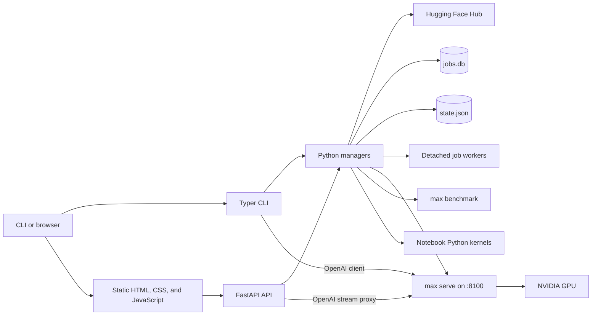

# mxstudio: Architecture and Current Understanding

This document records a code-level understanding of mxstudio as of 2026-08-05.
It is intended to make future MAX and Mojo work easier to place correctly.

## Executive summary

mxstudio is a small Python control plane and browser UI around Modular MAX. It
does not replace MAX's runtime. It discovers and downloads Hugging Face models,
starts one managed `max serve` process, proxies its OpenAI-compatible API,
runs benchmarks, generates educational notebooks, and guides custom MAX
architecture bring-up.

The system currently uses MAX directly in four ways:

1. `max list --json` supplies architecture discovery when available.
2. `max serve` hosts a downloaded model on port 8100.
3. `max benchmark` measures the live endpoint, with a simpler stream-timing
   fallback.
4. Python custom-architecture packages import `max.graph` and `max.pipelines`.

There is no `.mojo` source, Mojo compiler invocation, or Mojo runtime process in
the repository today. The Learn tab links to Mojo material and includes static
GPU/Mojo visualizers, but these are educational assets rather than live Mojo
tool execution.

## System shape

The package deliberately keeps the web server out of expensive model work.
Downloads and benchmarks use workers, durable operations can use detached
processes, and model serving always runs in its own process group.

## Entry points and layers

### User entry points

- `mxstudio/__main__.py` and `mxstudio/cli.py` expose the Typer CLI through
  `pixi run mxs`.
- `mxstudio/cli.py:ui` starts Uvicorn and the FastAPI application.
- `mxstudio/api.py` exposes REST endpoints, server-sent chat events, and the
  static web application.
- `mxstudio/web/index.html`, `app.js`, and `app.css` form a no-build frontend.
  The browser polls jobs and server state and streams chat through the API.

### Domain modules

| Module | Responsibility |
| --- | --- |
| `registry.py` | Curated model metadata, device assignment, custom-port path, and serve eligibility. |
| `compat.py` | Hugging Face metadata checks, approximate MAX architecture matching, disk/token checks, and VRAM guidance. |
| `downloads.py` | Filtered Hugging Face snapshot downloads, progress estimation, installation detection, and uninstall. |
| `servers.py` | Lifecycle, health, logs, and persisted identity of the single `max serve` process. |
| `bench.py` | `max benchmark` command construction, result normalization, stream fallback, and benchmark history. |
| `architectures.py` | Inspect, gap analysis, non-overwriting scaffolding, and smoke checks for custom MAX packages. |
| `notebooks.py` | Notebook generation, editing, execution, and per-notebook Python kernels. |
| `slides.py` | Reveal slide sidecars generated from model/notebook metadata. |
| `jobs.py`, `job_worker.py`, `jobs_db.py` | Background dispatch, detached workers, heartbeats, and SQLite job persistence. |
| `hwinfo.py` | NVIDIA, CPU, memory, disk, and WSL observations. |
| `settings.py`, `state.py`, `pathops.py` | Secrets, lightweight state, and contained OS file-manager operations. |
| `fhsaas.py` | Logging setup and the additive jobs API bridge supplied by `fh-saas`. |

`api.py` is the composition root. It validates HTTP input and delegates to these
modules; both the API and CLI reuse the same singleton download, server, and
benchmark managers.

## Core workflows

### Check and download a model

1. A curated model comes from `registry.REGISTRY`; the UI also accepts an
   arbitrary Hugging Face `org/name`.
2. `compat.check_hf_model()` reads Hub metadata and `config.json`, checks for
   safetensors, estimates download size and VRAM fit, and compares the declared
   architecture with known/MAX-listed architectures.
3. The web path queues a `download` job. Downloads are detached jobs so a UI
   restart does not abandon them; the worker then starts the Hugging Face
   download thread and mirrors progress into SQLite.
4. `snapshot_download()` excludes formats such as PyTorch `.bin`, GGUF, ONNX,
   and other alternate weights. An installation is recognized when a snapshot
   contains `config.json` and at least one `.safetensors` file.

Compatibility is advisory. The architecture test combines a maintained name
allowlist with fuzzy matching against `max list`; it is not proof that graph
compilation or serving will succeed. A force option allows informed downloads
despite architecture or hardware warnings.

### Serve and chat

1. `ServerManager.start()` stops any different managed model, preserving the
   invariant that mxstudio owns at most one model server.
2. It launches `max serve --model-path <hf-id> --port 8100
   --no-device-graph-capture` in a new process group. The pixi environment is
   added to `PATH`, and `CUDA_VISIBLE_DEVICES` comes from the registry entry.
3. Multi-GPU entries add `--devices` and `--ep-size`. Custom entries add
   `--custom-architectures <ports/package>`.
4. PID, model ID, port, log path, and start time are persisted. Health is
   determined from `GET /health`, not merely from process existence.
5. CLI chat calls MAX's OpenAI-compatible endpoint directly. Browser chat posts
   to FastAPI, which uses `AsyncOpenAI` and relays token deltas as SSE, avoiding
   browser CORS coupling to the model server.

The unconditional `--no-device-graph-capture` is a WSL-oriented compatibility
choice. It is currently applied on every platform rather than selected from
hardware detection.

### Benchmark

The benchmark path first requires a healthy managed server and checks basic GPU
and memory readiness. `BenchManager` prefers:

MAX JSON output is normalized across several possible metric names. If the CLI
is unavailable, exits unsuccessfully, or does not write its result file, the
manager times streamed OpenAI responses instead. Results explicitly identify
`max_benchmark` versus `openai_stream_fallback`; the latter is useful but is not
equivalent to a full MAX load benchmark. The UI's llama.cpp and vLLM comparison
series are future-facing rather than live managed measurements.

### Notebooks and slides

Model metadata and Hugging Face sources are turned into repository-local
`.ipynb` files and versioned `.slides.json` Reveal sidecars. The browser can
load, edit, save, and execute notebook cells. Execution uses a Python subprocess
per notebook, not a Jupyter server. A run-all resets state and stops at the
first failing code cell.

Notebook examples exercise the local MAX OpenAI endpoint. They teach model and
serving concepts but do not execute Mojo code.

### Custom MAX architecture bring-up

The Architectures wizard is intentionally a guided workflow, not an automatic
port generator:

1. Inspect the Hugging Face architecture and compare it with MAX support.
2. Explain missing config, graph, registration, weight-map, and package pieces.
3. Scaffold a package under `ports/` without overwriting existing human edits.
4. Let a human or coding agent implement the real MAX graph and adapters.
5. Smoke-check file presence, Python syntax/imports, and remaining TODOs.
6. Hand off to an actual `max serve --custom-architectures ...` attempt.

A passing smoke check does not mean the package compiles or serves. The included
OLMoE package now compiles, loads weights strictly, and serves local chat on the
development machine; numerical parity validation is still pending. The MAX-native
Qwen3 MoE entry remains useful for studying sparse serving, although its FP8
grouped matmul requires newer GPU architecture than an RTX 3090.

## Concurrency and persistence

There are three kinds of asynchronous work:

- Threads handle lightweight in-process jobs, Hugging Face download activity,
  benchmark management, and notebook execution bookkeeping.
- Detached Python workers handle downloads and architecture analyze/scaffold/
  smoke operations that should survive web UI restarts. A five-second heartbeat
  keeps their SQLite records fresh.
- External process groups isolate `max serve`; notebook kernels and MAX CLI
  probes are separate subprocesses as well.

Persistent state lives in these locations:

| Location | Contents |
| --- | --- |
| `~/.mxstudio/state.json` | Managed server metadata and the last 50 benchmark summaries. |
| `~/.mxstudio/jobs.db` | Durable job states, progress, errors, and JSON results. |
| `~/.mxstudio/secrets.json` | Hugging Face token, atomically written with restrictive permissions. |
| `~/.mxstudio/logs/` | Model-server and detached-worker logs. |
| `~/.mxstudio/bench_results/` | Raw `max benchmark` JSON. |
| Hugging Face cache | Snapshots, blobs, configs, tokenizers, and safetensors. |
| `notebooks/` | Generated notebooks and slide sidecars. |
| `ports/` | Generated and hand-edited MAX custom architecture packages. |

Most state respects `MXSTUDIO_HOME` through `state.HOME`. Benchmark result files
currently use `Path.home() / ".mxstudio"` directly, so they are an exception.
Download manager progress is process-local; the outer SQL job preserves durable
status for the web workflow.

## Important invariants

- Only one mxstudio-managed model server may run at a time, on port 8100.
- A model must be downloaded before it can be served.
- Registry entries marked `serve_enabled=False` are blocked by the API.
- Long network or model operations should not run on a normal API request
  thread; explicit synchronous/debug routes are exceptions.
- Architecture scaffolding must not overwrite implementation work.
- File-manager operations are constrained to known roots to prevent path escape.
- Notebook metadata is preserved when cells are saved.
- Job state is mapped to the `fh-saas` public state vocabulary while retaining
  mxstudio's raw queued/processing distinction.

## Tests and confidence

The current test suite focuses on reliability boundaries rather than live GPU
execution:

- API behavior, job input, parked-model rejection, and folder routes.
- Architecture root resolution, detached jobs, metadata lookup, and
  non-overwriting scaffolds.
- Notebook metadata, model validation, slides, and persisted generation jobs.
- Partial hardware reporting and WSL path handling.
- Allowed-root containment for path operations.

There is no automated integration test that launches `max serve`, compiles a
custom architecture, runs `max benchmark`, or executes Mojo. Those behaviors
still require an environment with Modular MAX, model weights, and suitable GPU
hardware.

## Practical extension points

For deeper MAX usage, the natural extension points are `servers.py` for serve
flags and lifecycle, `compat.py` for capability discovery, `bench.py` for MAX
measurement, and `ports/` for real custom architectures.

For real Mojo tooling, add an explicit execution boundary rather than treating
the static Learn assets as tooling. A minimal vertical slice would define a
curated Mojo example, discover the Mojo executable from the pixi environment,
run it in a bounded subprocess, capture structured output/logs as a SQL job, and
surface the result in the Learn UI. GPU examples would also need device checks,
timeouts, and a clear distinction between compilation failure and runtime
failure.