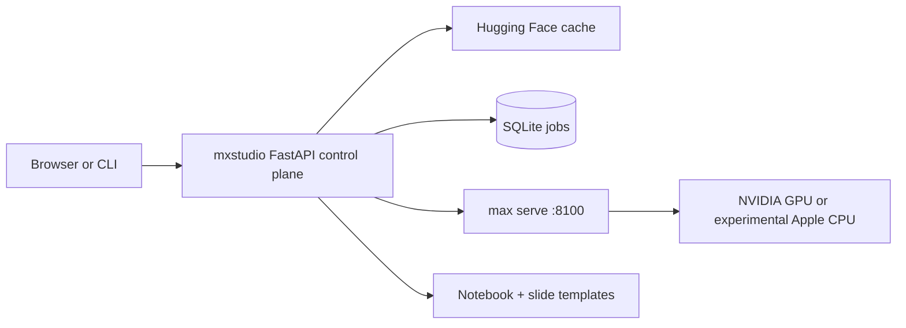

# MX Studio user guide

[Back to the concise README](../README.md) · [Endpoint-first mission and current gaps](ENDPOINT_FIRST.md)

The core mission is the simplest terminal path from one model to a secure,
verified MAX endpoint. This guide contains the detailed usage previously in the
README, including optional browser, notebook, and inference-engineering features.
Those features remain available but are not prerequisites for the endpoint-first product.

> **Project status:** early and experimental. Curated dense models are the easiest place to start. Architectures is a beta workflow: inspection and scaffolding are automated, while graph implementation and numerical validation remain engineering work. For porting unsupported architectures with mxconsole (`mxc port --auto`), including the OLMoE port, which now passes the numerical parity check, see [PORTING.md](PORTING.md).

## Start here

**For one local appliance, start with FastAPI + SQLite + MAX. PostgreSQL is not required.**

| What you want to do | Start here | What success looks like |
| --- | --- | --- |
| Browse, download, chat, and learn in the browser | [Install](#install), then [First ten minutes](#first-ten-minutes) | A real model answers; an editable lab opens. |
| Give an application a local OpenAI-compatible endpoint | [Nucleus quickstart](#optional-nucleus-appliance-profile) | Your app receives streamed tokens using a key and model name. |
| Connect phones or other LAN clients over HTTPS | [HTTPS and discovery](MXSTUDIO_NUCLEUS.md#https-and-discovery) | Another device resolves the hostname, trusts the CA, and completes a request. |
| Issue a different, revocable key to each app | [Optional gateway](MXSTUDIO_NUCLEUS.md#optional-litellm-virtual-keys-and-cloud-routing) | LiteLLM validates app-specific keys; this profile adds PostgreSQL. |
| Check whether the original appliance specification is finished | [Requirement checklist](MXSTUDIO_NUCLEUS.md#does-this-complete-the-original-specification) | Separate implemented code from behavior still needing target-machine evidence. |

### Backend and database: what is actually used?

- **Backend: FastAPI, not FastHTML.** Uvicorn runs the HTTP application. The browser uses static HTML/CSS/JavaScript; Typer provides the CLI. The `fh-saas` dependency supplies job-interface and logging utilities, not a FastHTML application here.
- **SQLite already stores durable jobs** in `~/.mxstudio/jobs.db`. Model-process state and benchmark history use `state.json`; model weights use the Hugging Face cache. `MXSTUDIO_HOME` changes the state directory.
- **PostgreSQL belongs only to the optional LiteLLM virtual-key profile.** The supplied gateway configuration uses it for gateway records; MAX and the Studio controller do not need it. SQLite is not a drop-in `DATABASE_URL` replacement in that configured profile.
- **Recommendation:** keep SQLite for this single-appliance workflow. Skip LiteLLM/PostgreSQL until separate app keys or gateway routing justify them. Core Nucleus uses one shared controller key; it does not yet offer SQLite-backed per-app key management, budgets, or independent revocation.

No backend migration or database migration is needed to use the simple path.

## Longer-term Studio vision

The endpoint-first mission comes first. Beyond that core, the longer-term ambition
is to make MX Studio a local AI harness for discovering, adapting, and understanding
models with MAX—as approachable as Ollama or LM Studio. The following Studio and
learning experiences are extensions, not requirements for getting one model online.

The experience we are building toward:

- **From model to application, with command-line simplicity.** Choose a model from the MAX ecosystem or Hugging Face, get its model-card information, license, hardware needs, and compatibility guidance immediately, then download and run supported models with minimal ceremony. For unsupported checkpoints, make conversion or architecture porting a guided, testable path rather than a promise that every model will just work.
- **A studio that opens up as you learn.** Move from chat and applications into editable Jupyter notebooks and the Python and Mojo code behind MAX workflows. Inspect, experiment, and connect changes in code to changes in model behavior and performance.
- **Inference engineering as a hands-on experience.** Build high-quality tutorials around real models: GPU execution and memory, MAX graphs and compilers, MAX serving, profiling, benchmarking, and optimization. Starting should feel as simple as running an Ollama command; deeper questions should lead to runnable experiments.
- **A GUI when useful, a terminal whenever preferred.** Make core workflows available through composable commands and APIs, without requiring a browser. The GUI should be optional and easy to leave behind. Keep terminal use natural on Arch Linux and make the same workflows approachable on macOS.
- **A foundation for exceptional local applications.** Bring model discovery, serving, learning, and application development together so users can build capable local AI systems on hardware they control, not just launch isolated model demos.

The long-term hardware ambition includes high-memory Apple silicon workstations: select a model, understand whether it fits, and run it with minimal setup. A desired M5 Ultra-class Mac with 512 GB of unified memory is an aspirational deployment target, not a claim of hardware availability or verified MAX support. Today's Apple silicon preview is experimental CPU serving; Apple GPU inference is not enabled.

Ultimately, the goal is to make it possible to build and sell local AI workstations and applications for legal and health professionals. That requires more than model performance: privacy and security controls, model-license compliance, domain evaluation, human oversight, and applicable regulatory work must precede professional deployment. MX Studio does not currently claim that readiness.

These are product goals, not a list of shipped features. The workflows and boundaries below describe what is available today.

## Why mxstudio exists

Model serving often starts with scattered commands, architecture compatibility guesses, and little connection between the model paper and the process running on the GPU. mxstudio puts those pieces next to each other:

- **Models:** discover curated or cached Hugging Face checkpoints and manage downloads.
- **Serve and Chat:** run one managed `max serve` process with an OpenAI-compatible API.
- **🧭 Local Agent:** let a served model inspect mxstudio through bounded, read-only tools with a visible trace.
- **Notebooks and Slides:** generate editable, cited lessons for each model.
- **Benchmark:** measure time to first token and generation throughput on this machine.
- **Architectures:** inspect MAX support and guide custom architecture bring-up honestly.
- **Learn:** connect model systems concepts to compact GPU and Mojo learning material.

Today, mxstudio is intended for learners, MAX evaluators, and developers porting open models. It is not yet a production inference control plane or an automatic model-porting service.

## Does it use an LLM to create notebooks or slides?

**No. Notebook and slide generation is deterministic and local.** Python templates combine the curated model registry with a programmatically filtered excerpt from the Hugging Face model card. No model is prompted to write the lesson, and no cloud LLM API is used.

| Activity | Local model required? |
| --- | --- |
| Open the UI and browse Models or Learn | No |
| Inspect hardware and MAX compatibility | No |
| Generate or read a notebook and slide deck | No |
| Fetch a fresh Hugging Face model-card excerpt | No model; internet may be needed |
| Scaffold a custom architecture package | No |
| Chat, run notebook inference cells, or benchmark generation | **Yes** |

Generated notebook code calls the local OpenAI-compatible MAX endpoint only after you choose **Serve**. The static Learn material and GPU visualizers do not execute Mojo; they are explanatory assets. Custom MAX graph implementation remains engineering work for a person or coding agent.

## 🧭 Local agent

Open the floating chat panel and switch from **Chat** to **Agent**. The active local MAX model can gather evidence from mxstudio before answering:

- 🔎 inspect the active MAX server and served model;
- 🖥️ read the local CPU, GPU, memory, and disk summary;
- 📊 read recent benchmark results;
- 🧾 show every tool call and result inline before the final answer.

The agent is deliberately bounded: tools are allowlisted and read-only, and a configurable maximum step count stops repeated tool calls. It cannot execute arbitrary commands, edit files, download models, or control the server.

> **Model requirement:** Agent mode needs a served model and chat template that support OpenAI-style tool calls. Ordinary Chat mode remains available for models without tool support.

## Recommended first model

Model weights are **not bundled** with mxstudio. Bundling would make the repository large, complicate model licenses, and choose hardware requirements on the user's behalf. Hugging Face downloads also remain reusable in the normal local cache.

For a first run, use **Qwen2.5 0.5B Instruct**:

- about 1 GB to download;
- ungated and Apache 2.0 licensed;
- quick to compile and serve;
- sufficient for testing chat, streaming, notebooks, and the OpenAI API.

Treat it as a starter cartridge, not a permanent default. Once the workflow is clear, switch to a larger or more specialized model from the Models catalog.

## Requirements

- Linux x86-64, WSL2, or Apple silicon macOS
- For the primary serving path, a supported NVIDIA GPU and working driver (`nvidia-smi` should succeed)
- On Apple silicon, enough unified memory for the model and experimental MAX CPU serving
- [Pixi](https://pixi.sh/) for the isolated project environment
- Git
- Internet access for initial packages and model downloads
- A Hugging Face token only for gated models such as Llama or Gemma

MAX is installed into the repository-local Pixi environment. mxstudio does not modify the system Python environment.

> **Apple silicon preview:** mxstudio installs natively on `osx-arm64` and starts MAX with `--devices cpu`. This is suitable for learning the workflow with a small model such as Qwen2.5 0.5B. It does not enable Apple GPU inference, and serving or benchmarking will be slower than the NVIDIA GPU path.

## Install

1. Install Pixi if it is not already available:

```sh
   curl -fsSL https://pixi.sh/install.sh | sh
```

Start a new shell after installation, or add `~/.pixi/bin` to `PATH`.

2. Clone and enter the project:

```sh
   git clone https://github.com/abhisheksreesaila/mxstudio.git
   cd mxstudio
```

3. Create the isolated environment:

```sh
   pixi install
```

4. Start mxstudio:

```sh
   pixi run mxs ui --host 127.0.0.1
```

5. Open <http://localhost:8080>.

If port 8080 is occupied, start the CLI directly with another port:

```sh
pixi run mxs ui --host 127.0.0.1 --port 8081
```

## First ten minutes

### Browser workflow

1. Open **Models**.
2. Download **Qwen2.5 0.5B Instruct**.
3. Select **Serve** and wait for the status to become **Running**.
4. Open Chat and send a short prompt.
5. Select **Details → Create lab** to generate its notebook and slides.
6. Run the notebook cells, then use **Benchmark** to measure this machine.
7. Return to Models and choose a different checkpoint when you need more capability.

### CLI workflow

```sh
pixi run mxs list
pixi run mxs download qwen2.5-0.5b
pixi run mxs serve qwen2.5-0.5b
pixi run mxs chat "Explain grouped-query attention in three bullets."
pixi run mxs notebook qwen2.5-0.5b
pixi run mxs bench --runs 3
pixi run mxs stop
```

Model names resolve by a unique substring, so `qwen2.5-0.5b`, `smollm`, and `olmoe` can be used instead of full Hugging Face IDs.

### Automated first-run acceptance test

The live harness follows the same path as a new user: it verifies the environment and Hugging Face metadata, downloads the public Qwen2.5 0.5B checkpoint, creates its notebook and presentation, starts MAX, streams one chat response, and stops the server it started.

```sh
pixi run python scripts/first_run_live.py
```

No Hugging Face token is required for this model. The harness refuses gated models, unsupported models, and replacement of an already-running server. Its first run downloads about 1 GB and may take several minutes to compile and serve. The hermetic regression test, which does not download weights or start MAX, is:

```sh
pixi run python -m unittest tests.test_first_run_acceptance
```

## Hugging Face access

Public models need no token. For gated or private models, create a read token in Hugging Face and save it from **Settings**. mxstudio stores it at `~/.mxstudio/secrets.json` with restrictive permissions. Never commit a token.

Before downloading an arbitrary `org/model`, mxstudio checks its config, safetensors, disk estimate, approximate VRAM fit, and declared architecture. Compatibility is advisory: a successful check is not proof that graph compilation or serving will work.

## What runs where



- The web UI and REST API run on port 8080 by default.
- A single managed `max serve` process runs on port 8100.
- Slow work such as downloads and benchmarks runs as background jobs.
- Browser chat proxies MAX's streaming OpenAI-compatible response.
- Agent mode uses `/api/agent` and exposes each read-only tool call and result as an SSE trace.
- Generated notebooks live under `notebooks/`; custom ports live under `ports/`.
- Runtime state and logs live under `~/.mxstudio/`.

## Repository map

For a deeper code-level description, see [the architecture guide](MXSTUDIO_ARCHITECTURE.md).

## Optional Nucleus appliance profile

Nucleus lets another application use your local model through an authenticated
OpenAI-compatible API. It shares the existing MAX process manager, prevents
model swaps during managed inference, and provides bounded preparation jobs.
The GUI, Caddy, LiteLLM, PostgreSQL, and mDNS are **not needed for a localhost trial**.

### 1. Prepare a model and start the API

Stop a previously running Studio web listener before using the same port 8080.
Run from this checkout in **terminal A**, using Bash and a long, random key saved
in your password manager. The prompt avoids writing the key into shell history.
The download uses the network; preparation launches real MAX and can take minutes.

```bash
pixi install
pixi run mxs download Qwen/Qwen2.5-0.5B-Instruct
export NUCLEUS_MODEL_ID=Qwen/Qwen2.5-0.5B-Instruct
read -rsp 'Paste your Nucleus API key: ' MXSTUDIO_NUCLEUS_API_KEY; echo
export MXSTUDIO_NUCLEUS_API_KEY
pixi run mxs nucleus prepare --timeout 600
# Continue only after preparation reports ready.
pixi run mxs nucleus run --no-prewarm
```

This prepares first, then runs the API in the foreground. The ordinary
`nucleus run` command instead queues prewarming automatically. Do not launch a
second controller; a successful model listing alone does not prove inference works.

### 2. Make a real streaming request

In **terminal B**, enter the same checkout and paste the **same key**. Environment
variables are not automatically shared between terminals. Keep the same user,
`MXSTUDIO_HOME`, and Hugging Face cache if you customized them.

```bash
read -rsp 'Paste the same Nucleus API key: ' MXSTUDIO_NUCLEUS_API_KEY; echo
export MXSTUDIO_NUCLEUS_API_KEY
pixi run python - <<'PY'
import os
from openai import OpenAI

with OpenAI(
    base_url="http://127.0.0.1:8080/v1",
    api_key=os.environ["MXSTUDIO_NUCLEUS_API_KEY"],
    timeout=90.0,
    max_retries=0,
) as client:
    print("Configured models:", [model.id for model in client.models.list().data])
    with client.chat.completions.create(
        model="nucleus-local",
        messages=[{"role": "user", "content": "Explain what a local AI endpoint does in two sentences."}],
        max_tokens=128,
        stream=True,
    ) as stream:
        for chunk in stream:
            if chunk.choices:
                print(chunk.choices[0].delta.content or "", end="", flush=True)
    print()
PY
```

**Success means generated text appears**, not just that the HTTP server starts.
This client uses localhost, not OpenAI's cloud. If it fails, use
`pixi run mxs nucleus status` and `pixi run mxs logs --lines 80`;
[troubleshooting](MXSTUDIO_NUCLEUS.md#troubleshooting) explains the common errors.

### 3. Point an application at it

| Application setting | Local trial | LAN deployment after Caddy/TLS setup |
| --- | --- | --- |
| OpenAI-compatible base URL | `http://127.0.0.1:8080/v1` | `https://api.mxstudio.local/v1` |
| Model | `nucleus-local` | `nucleus-local` |
| API key | Your controller key | Controller key for core; app-specific key for LiteLLM |

Use a client that supports a custom base URL and **chat completions**. This is not
an implementation of every OpenAI endpoint: Responses, embeddings, image, speech,
and transcription routes are not exposed. On a phone, `127.0.0.1` means the phone,
not the appliance. Touch/voice applications themselves are not included.

### 4. Inspect, learn, and stop

```bash
pixi run mxs nucleus status
pixi run mxs bench --runs 3
pixi run mxs nucleus lesson --output nucleus-ttft.ipynb
```

Open the generated notebook in VS Code/Jupyter, select the project Python kernel,
and follow its environment setup. It measures first-token latency when executed;
keep the hardware/model context with the results. Generation alone runs no inference.

To stop the foreground API, press **Ctrl+C in terminal A**. CLI-launched MAX can
outlive it; run `pixi run mxs stop` when active requests have finished. Jobs, logs,
and downloaded weights remain on disk.

See [the full Nucleus guide](MXSTUDIO_NUCLEUS.md) for deployment profiles,
private preparation jobs, TLS trust, discovery, and a requirement-by-requirement
acceptance checklist. **Do not treat implementation plus unit tests as proof that
the original Apple-Silicon Linux appliance is finished.**

## Current boundaries

- MAX architecture checks are guidance, not compile proof.
- The custom architecture wizard scaffolds structure; it does not invent a correct graph.
- OLMoE compile, strict weight loading, and local chat are verified on the development machine, but numerical parity remains to be validated.
- Mojo tutorials and visualizers are currently static educational content.
- One model is served at a time to avoid accidental VRAM overcommit.
- Live GPU/MAX integration still depends on the user's hardware and driver environment.

## Contributing

Useful contributions include verified model metadata, MAX architecture adapters, notebook lessons, hardware reports, benchmark evidence, and reliability tests. When reporting a serving result, include the GPU, driver, MAX version, model ID, command, and relevant log tail.

## License

Project licensing has not yet been declared in this repository. Model weights retain their publishers' licenses; check every model card before redistribution or deployment.